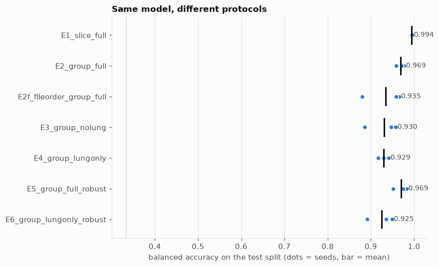
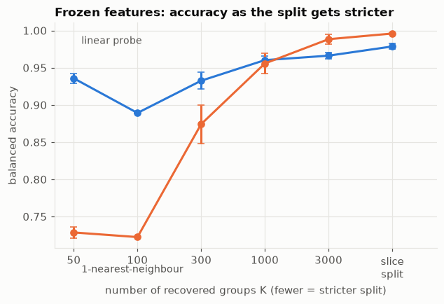
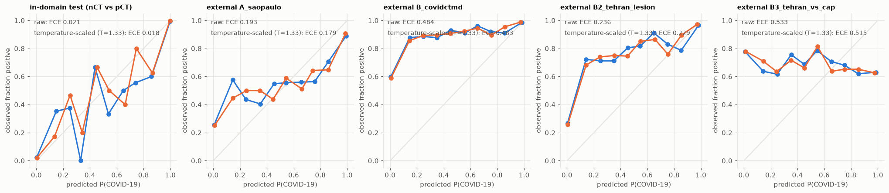

# Beyond 99%: Auditing Leakage, Shortcuts and Calibration in COVID-19 CT Classification

**Sayantan Bhattacharya** · 12 October 2026 (preprint v1.0)

*Department of Computer Science and Engineering (AI and ML), Techno Main Salt Lake, Kolkata, India. Correspondence: sayantanbhattacharyauni@gmail.com. Preprint, not peer-reviewed. Code: https://github.com/PopcornKitsilano/covid-ct-audit*

## Abstract

Public CT benchmarks for COVID-19 report slice-level accuracy above 99%, yet slices from one scan are near-duplicates and most datasets ship without patient IDs. We audit a MobileNetV3-Large classifier on a 19,685-slice, three-class CT dataset (non-COVID, COVID, non-informative) along four axes: leakage, shortcuts, external validity and calibration.

Replacing a random slice split with a group split on recovered pseudo-patients lowers accuracy from 99.42% to 97.18%, and to 95.39% when groups follow file order. The error rate rises 4.9 to 8.0 times, and recall of COVID slices falls from 99.6% to 96.0% and 88.8%. Scalar acquisition features alone reach 0.996 balanced accuracy under a slice split and 0.630 under a group split (chance 0.333), and models trained without the lungs, or with only the lungs, both reach about 93%. On two external sites, discrimination drops (AUROC 0.83 on Sao Paulo; 0.86 for COVID lesion slices against normal patients in Tehran), and every model scores community-acquired pneumonia as more COVID-like than COVID (AUROC 0.43 to 0.49). Calibration does not transfer: binary ECE rises from 0.02 in-domain to 0.19 to 0.53 externally, and temperature scaling recovers at most 0.034.

Because the main dataset has no patient IDs, we tested our grouping against true IDs on the Tehran cohort. It recovers patients poorly (adjusted Rand index at most 0.29). A nearest-neighbour probe scores 0.998 under a random slice split, 0.551 under a true patient split and 0.717 under our recovered groups, so the slice-versus-group gaps we report are lower bounds on true patient-level leakage.

## 1. Introduction

A public implementation of this classifier reports 99.76% test accuracy on a three-class CT slice dataset [18]. That number answers a narrower question than it appears to: how well does the model recognise slices whose neighbours it has already seen? Slices from one CT scan are near-duplicates of each other. Under a random slice split almost every test slice has a near-identical twin in training, so a model can succeed by recognising the scan and not the disease.

Most public CT collections also omit patient identifiers, so the usual remedy, splitting by patient, is not possible. A reader cannot tell how much of a headline accuracy is leakage, how much is an acquisition shortcut, and how much would survive a change of hospital.

We treat this as a measurement problem and not a modelling one. We do not try to beat the reported accuracy. We measure how far it falls under progressively more honest evaluation, and we check our own proxy for patient identity against true patient IDs wherever they exist. Our contributions:

1. **A leakage audit with two independent pseudo-patient groupings** (feature clustering and file-order contiguity). We report the slice-versus-group gap over three seeds with effective-sample-size corrections, and training-free probes that measure leakage directly.
2. **A shortcut analysis** that combines acquisition-feature classifiers, trained and test-time lung ablations, a Shortcut Reliance Index and Grad-CAM lung enrichment, together with a quality check of the lung masks.
3. **External validation on two sites**, including a corrected Tehran evaluation with radiologist lesion labels (COVID lesion slices against normal patients, and against community-acquired pneumonia), and a calibration study showing that in-domain temperature scaling does not transfer.
4. **A direct test of the grouping proxy against true patient IDs.** Recovery is poor, and the recovered split keeps about a third of the leakage a random split has, so the gaps reported on the main dataset are lower bounds.
5. **A single script** that reruns the whole audit on one 8 GB consumer GPU (all 21 training runs took 44.6 minutes).

The contribution is an audit protocol and its evidence, not a new architecture. Section 2 places it relative to earlier critiques, and Table 1 summarises the findings.

| Audit | Test | Result |
| --- | --- | --- |
| Leakage | Slice split versus group split | Accuracy 99.42% to 97.18% (feature groups) and 95.39% (file-order groups). Error rate ×4.9 and ×8.0. COVID recall 99.6% to 96.0% and 88.8%. |
| Leakage, no training | 1-nearest-neighbour on frozen features | Balanced accuracy 0.996 (slice) to 0.874 (K = 300) to 0.722 (K = 100). Tehran with true IDs: 0.998 to 0.551. |
| Shortcuts | Scalar acquisition features only | Balanced accuracy 0.996 (slice split), 0.630 (group split); chance 0.333. |
| Shortcuts | Lung ablations | Lungs removed 0.930, lungs only 0.929; SRI 0.94. E2 model at test time: lungs removed 0.379 accuracy. |
| External validity | AUROC, COVID versus rest | Sao Paulo 0.83; Tehran lesion versus normal 0.86; Tehran COVID versus CAP 0.43 (E2). |
| Calibration | Binary ECE, E2 seed 0 | 0.02 in-domain; 0.19 (Sao Paulo), 0.24 (B2), 0.53 (B3). Temperature scaling gains at most 0.034. |
| Proxy validation | Recovered groups versus true Tehran patients | ARI at most 0.29, pair recall at most 0.28. Recovered split retains 37% of the near-duplicate advantage. |

*Table 1.* The audit at a glance. Every number is a mean over three seeds unless marked; sources are Tables 8 to 16.

## 2. Related work

The concern that COVID-19 imaging models learn artefacts is not new, so this paper's novelty is moderate and should be read as such.

**Methodological reviews.** Roberts et al. reviewed machine-learning models for COVID-19 on chest radiographs and CT and judged none of potential clinical use, citing methodological flaws and underlying biases [1]. Wynants et al. reached a similar verdict for COVID-19 prediction models generally [2]. Kapoor and Narayanan catalogue data leakage as a cause of irreproducible results across machine-learning-based science [3].

**Shortcut learning and site confounds.** DeGrave et al. showed that radiographic COVID-19 detectors can select shortcuts in the data source over pathology and generalise poorly to new hospitals [4]. Zech et al. found that a pneumonia detector's performance varied across hospital systems [6], and Geirhos et al. describe the general phenomenon of shortcut learning [5]. Studies of chest X-ray datasets reported that classifiers keep working after the lungs are removed from the image [7, 17]. Our lung-ablation analysis applies this idea to CT slices and summarises it in a single index.

**Slice-wise splits on CT.** Parsarad et al. argue that many CT classifiers report unreliable accuracy because they split slice by slice, and they release a dataset with subject-wise splits on which earlier models' accuracy does not hold up [24]. We differ in three ways: our main dataset has no patient identifiers, so we recover groups and test the recovery against true IDs on a second site; we add shortcut and ablation analyses; and we evaluate calibration across sites.

**CT datasets and external validation.** Harmon et al. trained and tested a CT model on multinational patient-level data [8]. The three datasets we use come from the iCTCF resource [9], COVID-CT-MD [10] and a Sao Paulo collection [11].

**Calibration under shift.** Guo et al. showed that modern networks are over-confident and that temperature scaling repairs this in-distribution [12]; Ovadia et al. showed that calibration degrades under dataset shift [13]. We test this on CT across sites.

**What we add.** (a) Two proxy-group methods used side by side on a dataset without patient IDs. (b) A direct check of the proxy against true patient IDs, with the finding that it under-recovers patients and so understates leakage. (c) A calibration-under-shift study with a hard-negative external set (COVID versus CAP). (d) The protocol packaged as one script. Our literature search found prior work showing slice-split inflation on CT [24] but none that validates recovered groups against true IDs; we cannot rule out that such work exists, and we claim (b) only as far as our search went.

## 3. Data

We use one training dataset and two external sites. Only the Tehran cohort carries true patient IDs.

| Dataset | Role | Size | Labels | Patient IDs |
| --- | --- | --- | --- | --- |
| Kaggle preprocessed CT (azaemon), original slices | Train, validation, in-domain test | 19,685 slices: nCT 9,979; pCT 4,001; NiCT 5,705 | 3-class | No (the source reports about 104 patients [9]) |
| SARS-CoV-2 CT-scan, Sao Paulo [11] | External A | 2,481 slices; 1,252 COVID (50.5%) | COVID versus other lung disease | No |
| COVID-CT-MD, Tehran [10] | External B, B2, B3; group-recovery test | 305 patients: 169 COVID, 76 normal, 60 CAP | Patient-level for all; slice-level lesion labels for 79 patients | Yes |

*Table 2.* Datasets. The three Tehran evaluation sets are defined in Section 3.4.

### 3.1 Main dataset

The main dataset holds 19,685 slices: 9,979 nCT (50.7%), 4,001 pCT (20.3%) and 5,705 NiCT (29.0%). These counts match those reported for the iCTCF resource [9], which describes 19,685 manually labelled CT slices from 61 COVID-19 patients and 43 control cases; we take the Kaggle collection to be a repackaging of that resource, an inference from the identical counts because the Kaggle page does not name its source. Labels describe the imaging findings on each slice: nCT slices show features in both lungs unrelated to COVID-19 pneumonia, pCT slices show features associated with COVID-19 pneumonia, and NiCT slices do not capture the lung parenchyma well enough for any judgement [9]. The source therefore implies about 104 patients, or roughly 190 slices each. Our K = 300 pseudo-patient groups are about three times the true patient count, which fits the over-splitting of patients we measure in Section 8, and K = 100 (Table 9) is the closest to the true count. The Kaggle collection includes an original and a preprocessed copy. We use the original slices, read once, converted to 8-bit grayscale and resized to 224 × 224 (0.99 GB in memory). File names carry only a class prefix and a running number (nCT1, nCT10, ...), so no patient or scan identifier exists.


*Figure 1.* Six example slices per class. Window, zoom, table position and field of view vary within each class. pCT slices show ground-glass and consolidative opacities. NiCT slices cover the neck, shoulders and upper abdomen.

Slices differ in properties that say nothing about the lungs (Figure 2). Image dimensions are the clearest: the share of 512 × 512 images is 76.6% in nCT, 52.0% in pCT and 65.5% in NiCT (Table 3). A circular field of view, which leaves about 21% of a square image black (1 − π/4 = 21.5%), appears in a small share of nCT and NiCT slices and not at all in pCT in this plot. Mean intensity is unimodal in nCT and multimodal and lower in pCT. All images are square, so the aspect-ratio panel is uninformative.


*Figure 2.* Properties that say nothing about the lungs but differ by class are shortcut candidates: fraction of black pixels, corner brightness, mean intensity and aspect ratio (width / height). Blue nCT, orange pCT, green NiCT; histograms are density-normalised per class.

| Image size (px) | nCT | pCT | NiCT |
| --- | --- | --- | --- |
| 512 × 512 | 76.6% (7,641) | 52.0% (2,081) | 65.5% (3,739) |
| 575 × 575 | 11.6% (1,153) | 29.2% (1,170) | 19.8% (1,127) |
| 1211 × 1211 | 9.8% (981) | 18.7% (750) | 12.9% (738) |
| 574 × 574 | 2.0% (204) | none | 1.8% (101) |
| Total | 9,979 | 4,001 | 5,705 |

*Table 3.* Image dimensions by class (share of the class, count in brackets). The class mix of image sizes differs, so dimension and file size alone carry label information.

### 3.2 Does the file number encode scan order?

Because no scan ID exists, file numbering is the only structure that hints at scan order. We compare the median cosine similarity (in the 96-dimensional embedding of Section 4.2) between slices with consecutive file numbers and between random same-class pairs.

| Class | Consecutive file numbers | Random same-class pairs |
| --- | --- | --- |
| nCT | 0.323 | 0.021 |
| pCT | 0.964 | 0.009 |
| NiCT | 0.678 | 0.139 |

*Table 4.* Median cosine similarity of embeddings. A value far above the random baseline means that file order carries scan identity.

For pCT, consecutive file numbers are almost identical images (0.964), so file order nearly equals scan order. For nCT the relation is weak (0.323, though still above random), and for NiCT intermediate. File-order groups should therefore be a better proxy for pCT than for nCT.

### 3.3 External site A: Sao Paulo

Site A has 2,481 slices, 1,252 of them COVID (50.5%). Its negatives are other lung diseases, not healthy controls, and its images are often cropped. External A is therefore a harder and differently defined task than the training task, and results on it mix site shift with label-definition shift. It has no patient IDs.

### 3.4 External site B: Tehran (COVID-CT-MD)

COVID-CT-MD holds DICOM volumes from one imaging centre in Tehran (CC0). We build three evaluation sets from it.

- **B (preliminary).** The central 60% of slices of each of 245 COVID and normal patients: 9,800 slices, of which 6,760 carry the patient-level COVID label. Every central slice of a COVID patient is called positive, which adds label noise because many slices show no lesion. B is used for the group-recovery test (Section 8) and reported for completeness.
- **B2 (COVID lesion versus normal).** Radiologist-marked lesion slices of 54 COVID patients against central slices of normal patients. Of 8,048 labelled COVID slices, 3,779 are lesion slices; we keep at most 40 per patient, giving 2,039 positives against 3,040 negatives (5,079 slices, 40.1% positive).
- **B3 (COVID lesion versus CAP).** The same 2,039 COVID lesion slices against 842 lesion slices of 25 CAP patients (of 3,896 labelled CAP slices, 1,178 lesion slices, again at most 40 per patient). The set has 2,881 slices and 70.8% positives, so the average-precision baseline is 0.71.

**Label mapping.** `Slice-level-labels.npy` has 79 rows (54 COVID, 25 CAP). The `Label Index` column of `Index.csv` skips a value (first at P044), so 36 of 79 entries differ from their position and it cannot serve as a row number. We map each patient to the row at its position in the index order and order slices by DICOM `InstanceNumber`. A check of whether file numbers follow a 1-based or 0-based convention could not tell the two apart (both fit, with chance levels 1.0 and 0.991), which is why we do not rely on file numbers. Consistency check: with the positional mapping no patient has a lesion label beyond its last slice (0 of 79), while using `Label Index` directly 2 of 78 do (cap003, cap005), which is impossible if it were correct. This rules out the naive mapping but is not an independent confirmation of ours.

## 4. Methods

### 4.1 Splits

Each experiment uses a 72/14/14 train/validation/test partition built from seven folds: fold 0 is the test set, fold 1 the validation set and the rest training. The slice split uses `StratifiedKFold`; group splits use `StratifiedGroupKFold` and assert that no group appears on two sides. Test sets therefore differ slightly in size across split types (2,813 to 2,926 slices).

### 4.2 Pseudo-patient groups

The main dataset has no patient IDs, so we build two proxies.

1. **Feature groups.** Each slice is embedded as a 96-dimensional vector: a 64-component PCA of the frozen ImageNet MobileNetV3 pooled features, concatenated with a 32-component PCA of a 32 × 32 thumbnail. Average-linkage hierarchical clustering on cosine distance, cut at K clusters, defines the groups. Our operating point is K = 300.
2. **File-order groups.** Contiguity-constrained agglomerative clustering along file-number order within each class, so only neighbouring blocks merge. K = 300 as well.

| K | Groups | Largest group (share of data) | Singleton share | Mean size | Class purity |
| --- | --- | --- | --- | --- | --- |
| 50 | 50 | 0.070 | 0.000 | 393.7 | 0.864 |
| 100 | 100 | 0.039 | 0.000 | 196.9 | 0.908 |
| 300 (used) | 300 | 0.018 | 0.003 | 65.6 | 0.953 |
| 1,000 | 1,000 | 0.007 | 0.001 | 19.7 | 0.989 |
| 3,000 | 3,000 | 0.003 | 0.047 | 6.6 | 0.995 |
| File-order, 300 | 300 | 0.102 | 0.060 | 65.6 | 1.000 |

*Table 5.* Recovered groups. Class purity is the share of slices in the majority class of their cluster; it is 1.000 for file-order groups by construction.

The two groupings agree poorly (adjusted Rand index 0.105), so they are two different approximations of scan identity, and neither is ground truth. We use both so that conclusions do not hinge on one grouping.

### 4.3 Model and training

MobileNetV3-Large [15] with ImageNet-1k weights (torchvision `IMAGENET1K_V1`) and a head 960 → 1280 → ReLU → Dropout(0.2) → 3. AdamW [16], learning rate 1e-4, weight decay 1e-4, batch size 32, 8 epochs, mixed precision, and the checkpoint with the lowest validation loss is kept. Every experiment uses seeds 0, 1 and 2 on an RTX 3060 Ti (8 GB; PyTorch 2.14.1, CUDA 12.6).

*Basic* augmentation is a random zoom (scale 0.8 to 1.0) with shift, and a horizontal flip. *Robust* augmentation adds, to half of every batch, a random intensity window (lower bound drawn from 0 to 0.25, upper from 0.75 to 1), a gamma change (exponent e^u with u drawn from −0.4 to 0.4), a random circular field of view in 30% of images (radius 0.85 to 1.1 of the half-width), and Gaussian noise with standard deviation 0.02. After training, batch-norm statistics are recomputed on clean training images.

### 4.4 Lung masks

Masks come from a classical heuristic: Gaussian smoothing, exclusion of black surroundings that touch the border, Otsu thresholding, removal of border-connected dark regions, morphological opening and closing, hole filling, a body-hull filter, a per-component convex hull and a small dilation. A slice gets an empty mask when no air-like class is found. We inspected the masks visually (Figure 3) but did not compare them with ground-truth masks.

| Class | Median mask area (share of image) | Slices with empty mask |
| --- | --- | --- |
| nCT | 0.219 | 3.1% |
| pCT | 0.203 | 1.8% |
| NiCT | 0.000 | 83.0% |

*Table 6.* Mask quality control. Expected: nCT and pCT mostly non-empty, NiCT mostly empty. The 83.0% empty rate on NiCT matches the class definition, but 17% of NiCT slices receive a non-empty mask.


*Figure 3.* Mask quality control on eight slices per class (orange outline = heuristic lung region). Masks are plausible on most nCT and pCT slices, but in several the two lungs and the mediastinum between them share one outline, dense consolidation can be left out (one pCT slice), and some NiCT slices at the upper abdomen receive an outline around lung bases or air in the bowel. We treat every mask-based number as approximate.

### 4.5 Experiments

| ID | Split | Input | Augmentation |
| --- | --- | --- | --- |
| E1 | Slice | Full image | Basic |
| E2 | Feature groups | Full image | Basic |
| E2f | File-order groups | Full image | Basic |
| E3 | Feature groups | Lungs removed | Basic |
| E4 | Feature groups | Lungs only | Basic |
| E5 | Feature groups | Full image | Robust |
| E6 | Feature groups | Lungs only | Robust |

*Table 7.* Experiments. Each runs with seeds 0, 1 and 2. E3 and E4 apply the ablation in training and test; Section 6.3 also ablates the test input of an E2 model.

### 4.6 Shortcut measures

**Acquisition-feature classifiers.** Histogram-based gradient boosting (200 iterations, balanced class weights) on 15 scalar descriptors that contain no lung information by design: image width, height, aspect ratio, file size, bytes per pixel, mean and standard deviation of intensity, fractions of black (at most 8/255) and white (at least 247/255) pixels, mean of the four image corners, mean of a central square, and the means of the top and bottom rows and the left and right columns. A restricted version uses only width, height, aspect ratio, file size and bytes per pixel.

**Shortcut Reliance Index.** SRI = (BA\_ablated − 1/3) / (BA\_E2 − 1/3), where BA is balanced accuracy and 1/3 is chance. An SRI near 1 means the ablation costs nothing.

**Test-time ablation and Grad-CAM.** We show the seed-0 E2 model its own test slices as full images, with only the lungs, and with the lungs removed. For Grad-CAM we take the last convolutional feature map, target the predicted class, and divide the share of the heat map that falls inside the lung mask by the share of the image the mask covers (enrichment 1 = uniform). We use up to 300 test slices per class (nCT, pCT) whose mask covers at least 5% of the image.

### 4.7 External evaluation

External sets are binary (COVID versus not), so we score a slice by the model's pCT probability and report AUROC and average precision. Sensitivity and specificity use the model's own decision (the argmax equals pCT), and we also report the share of slices assigned to the non-informative class NiCT, a sign of distribution shift. AUROC for nCT versus pCT in-domain uses P(pCT) / (P(nCT) + P(pCT)) on nCT and pCT slices only.

### 4.8 Calibration

In-domain ECE is the 15-bin top-label ECE of the three-class output. External ECE is a 10-bin binary ECE on P(pCT) / (P(nCT) + P(pCT)) against the mapped binary label. **These are different estimators**, so Table 14 does not compare them directly; the like-for-like comparison is the reliability diagram (Figure 10), which uses the binary estimator on all panels. Temperature scaling divides the logits by one scalar T fitted on the in-domain validation set by minimising negative log-likelihood.

### 4.9 Statistics and probes

Results are means and sample standard deviations over the three seeds (the probe and metadata tables use the population formula). We add Wilson intervals, a cluster bootstrap over recovered groups (1,000 resamples), the design effect, and exact McNemar tests for paired comparisons (Appendix A.5).

Two frozen-feature probes measure leakage without training a network. A logistic regression (standardised 64-dimensional deep features, C = 0.5, balanced weights) and a 1-nearest-neighbour classifier (cosine similarity in the 96-dimensional embedding) are fitted on the training part of a split and scored on its test part, with three split seeds.

## 5. Results 1: the leakage gap

A random slice split overstates accuracy by 2.2 points with feature groups and 4.0 points with file-order groups, which multiplies the error rate by 4.9 and 8.0, and the COVID-positive class pays most of the cost. Table 8 gives mean ± SD over three seeds on each experiment's own test split.

### 5.1 Slice versus group splits

| Experiment | Test n | Accuracy | Balanced acc. | Recall pCT | AUROC nCT vs pCT | ECE | NLL |
| --- | --- | --- | --- | --- | --- | --- | --- |
| E1 slice split | 2,813 | 0.9942 ± 0.0014 | 0.9944 ± 0.0015 | 0.9959 ± 0.0020 | 1.0000 ± 0.0000 | 0.0030 ± 0.0008 | 0.0150 ± 0.0050 |
| E2 feature groups | 2,815 to 2,820 | 0.9718 ± 0.0053 | 0.9690 ± 0.0097 | 0.9602 ± 0.0349 | 0.9959 ± 0.0035 | 0.0153 ± 0.0068 | 0.1014 ± 0.0344 |
| E2f file-order groups | 2,926 | 0.9539 ± 0.0191 | 0.9346 ± 0.0475 | 0.8883 ± 0.1597 | 0.9987 ± 0.0019 | 0.0175 ± 0.0095 | 0.1327 ± 0.0485 |
| E3 lungs removed | 2,815 to 2,820 | 0.9266 ± 0.0332 | 0.9303 ± 0.0386 | 0.9319 ± 0.0766 | 0.9722 ± 0.0269 | 0.0382 ± 0.0064 | 0.2505 ± 0.0533 |
| E4 lungs only | 2,815 to 2,820 | 0.9222 ± 0.0080 | 0.9293 ± 0.0120 | 0.9260 ± 0.0608 | 0.9887 ± 0.0099 | 0.0315 ± 0.0080 | 0.2524 ± 0.0183 |
| E5 feature groups, robust | 2,815 to 2,820 | 0.9717 ± 0.0116 | 0.9695 ± 0.0164 | 0.9607 ± 0.0456 | 0.9971 ± 0.0029 | 0.0126 ± 0.0084 | 0.0939 ± 0.0443 |
| E6 lungs only, robust | 2,815 to 2,820 | 0.9193 ± 0.0231 | 0.9254 ± 0.0302 | 0.9116 ± 0.0682 | 0.9840 ± 0.0185 | 0.0390 ± 0.0208 | 0.2746 ± 0.0921 |

*Table 8.* In-domain results, mean ± SD over seeds 0, 1, 2. ECE is the 15-bin three-class estimator. E3, E4 and E6 are discussed in Section 6.



*Figure 4.* Balanced accuracy on each protocol's test split (dots are seeds, bars are means; the faint vertical line is chance, 0.333). Only the split changes between E1 and E2.

The per-seed accuracy gap between E1 and E2 is 2.70, 1.78 and 2.23 points. The error rate rises from 0.58% (E1) to 2.82% (E2) and 4.61% (E2f), factors of 4.9 and 8.0. COVID recall falls from 0.9959 to 0.9602 and 0.8883, so the share of COVID slices missed rises from 0.41% to 3.98% and 11.17%, factors of 9.7 and 27. AUROC for nCT versus pCT barely moves (1.0000, 0.9959, 0.9987), so the models still rank slices well while their decisions at a fixed threshold get worse.

COVID slices may pay most because they are the most redundant: consecutive pCT file numbers are almost identical images (Table 4), so a slice split leaks them more than nCT. We did not test this directly.

**Leakage is visible without the test set.** The validation loss at the selected checkpoint is 0.010 to 0.012 under the slice split, 0.081 to 0.164 under feature groups (about 10 times higher) and 0.190 to 0.281 under file-order groups (about 21 times higher; Appendix B). A leaky validation set also flatters calibration: E1 has ECE 0.0030 and NLL 0.0150, E2 has 0.0153 and 0.1014.

**Statistical caveats.** Test slices are correlated within scans. For E1 the 2,813 test slices come from about 291 recovered groups, giving a design effect of 1.2 and an effective sample size of about 2,399. The 95% interval for E1 accuracy is [0.9906, 0.9964] by Wilson and [0.9910, 0.9971] by cluster bootstrap, so clustering does not change the conclusion at this level. Group-split runs are noisy: validation balanced accuracy for E2 seed 1 fell to 0.866 mid-training, and E2f accuracy spreads from 0.9716 to 0.9337 across seeds (recall of pCT SD 0.16). We report all seeds and never select a best one.

**Robust augmentation.** E5 matches E2 in accuracy (0.9717 versus 0.9718). Paired exact McNemar tests give p = 0.115 (seed 0), 0.009 (seed 1, in favour of E5: 40 slices only E5 gets right against 19) and 0.324 (seed 2), so there is no consistent in-domain difference. For two of three E5 seeds the lowest validation loss came after epoch 1, so these models are barely trained; selecting on validation balanced accuracy might change this (Appendix B).

### 5.2 Leakage without training

Frozen-feature probes measure how much near-duplicate structure a split leaves in, without training a network (Table 9, Figures 5 and 6). Under a random slice split a nearest-neighbour classifier on frozen features reaches 0.996 balanced accuracy, so almost every test slice has a near-twin in training: the median similarity to the closest training slice is 0.989 under a slice split and 0.781 under the K = 300 group split. As groups get stricter (smaller K) the nearest-neighbour probe falls to 0.874 at K = 300 and 0.722 at K = 100. The linear probe barely moves (0.889 to 0.979) because it generalises instead of memorising.

| K (groups) | Linear probe, balanced acc. | 1-NN probe, balanced acc. |
| --- | --- | --- |
| 50 | 0.9358 ± 0.0065 | 0.7286 ± 0.0073 |
| 100 | 0.8892 ± 0.0005 | 0.7223 ± 0.0000 |
| 300 | 0.9325 ± 0.0113 | 0.8742 ± 0.0259 |
| 1,000 | 0.9602 ± 0.0056 | 0.9557 ± 0.0140 |
| 3,000 | 0.9662 ± 0.0041 | 0.9884 ± 0.0062 |
| Slice split (19,685) | 0.9786 ± 0.0036 | 0.9960 ± 0.0008 |

*Table 9.* Probe accuracy on the main dataset as the grouping gets stricter. SDs are over three split seeds (population formula).



*Figure 5.* Frozen-feature balanced accuracy against the number of recovered groups K. Blue: linear probe. Orange: 1-nearest-neighbour. Fewer groups means a stricter split.


*Figure 6.* Cosine similarity of each test slice to its closest training slice. A random slice split (blue) puts most test slices at 0.96 to 1.00; the K = 300 group split (orange) spreads them from 0.60 to 0.99 with a peak near 0.73.

**Read these curves with care.** They are partly circular. The groups were built in the same embedding space the probe uses, so a stricter grouping mechanically pushes test slices away from their training neighbours. The curves show how a probe responds to a grouping; they are not independent evidence about true patients. The non-monotone linear-probe values at K = 50 and 100 probably reflect folds with few, very large groups and different class mixes. Section 8 gives the independent check against true IDs.

### 5.3 How to read the gap

The two groupings give different gaps because their test sets and failure modes differ, so the gap is a range and not a point. Section 8 shows that feature-cluster groups under-recover true patients, so the E2 gap is likely a lower bound on the patient-level gap. File-order groups, which give the larger gap, have not been validated against true IDs.

## 6. Results 2: shortcuts

A classifier that never sees the lungs, or sees only the lungs, still reaches about 93% balanced accuracy, and scalar acquisition features alone identify slices almost perfectly under a slice split. Both point to label signal that is not lung pathology. Whether the standard model uses that signal is a separate question (Section 6.3).

### 6.1 Acquisition features

| Features | Slice split | Group split |
| --- | --- | --- |
| Image size and file size only (5 features) | 0.600 ± 0.008 | 0.391 ± 0.023 |
| All 15 scalar acquisition features | 0.996 ± 0.001 | 0.630 ± 0.013 |

*Table 10.* Balanced accuracy of gradient-boosted trees on features with no lung information (chance 0.333).

Under a slice split the scalar features nearly solve the task (0.996), which shows that they fingerprint neighbouring slices. Under a group split they fall to 0.630 but stay far above chance, so a residual acquisition signal survives grouping. This agrees with Figure 2 and Table 3: image dimensions and intensity statistics differ by class. Size features alone are close to chance under groups (0.391), so most of the residual signal sits in intensity and field-of-view statistics.

### 6.2 Lung ablations

| Experiment | Accuracy | Balanced acc. | Recall nCT | Recall pCT | Recall NiCT | AUROC nCT vs pCT | SRI |
| --- | --- | --- | --- | --- | --- | --- | --- |
| E2 full image | 0.9718 | 0.969 | 0.9787 | 0.9602 | 0.9681 | 0.9959 | 1.000 |
| E3 lungs removed | 0.9266 | 0.930 | 0.9139 | 0.9319 | 0.9452 | 0.9722 | 0.939 |
| E4 lungs only | 0.9222 | 0.929 | 0.8954 | 0.9260 | 0.9664 | 0.9887 | 0.938 |
| E5 full image, robust | 0.9717 | 0.969 | 0.9764 | 0.9607 | 0.9713 | 0.9971 | 1.001 |
| E6 lungs only, robust | 0.9193 | 0.925 | 0.8919 | 0.9116 | 0.9726 | 0.9840 | 0.931 |

*Table 11.* Models trained on ablated inputs, mean over three seeds. SRI is measured against E2, so E5's 1.001 and E6's 0.931 are relative to E2, not to their own full-image counterparts.

Each region alone keeps about 94% of the above-chance performance. The lungs are therefore not the only place where the label can be read. Both ablations cost about the same (0.93 against 0.97), so the label information is spread across the lung and non-lung regions and not concentrated in either.

### 6.3 Is the shortcut used? Test-time ablation and Grad-CAM

A shortcut being available does not mean the standard model uses it. We show the seed-0 E2 model its test slices in three ways (Table 12).

| Test input | Accuracy | Balanced acc. | Recall nCT | Recall pCT | Recall NiCT | AUROC nCT vs pCT |
| --- | --- | --- | --- | --- | --- | --- |
| Full image | 0.966 | 0.958 | 0.980 | 0.924 | 0.972 | 0.994 |
| Lungs only | 0.818 | 0.740 | 0.939 | 0.326 | 0.956 | 0.908 |
| Lungs removed | 0.379 | 0.422 | 0.119 | 0.158 | 0.989 | 0.827 |

*Table 12.* The seed-0 E2 model (trained on full images) shown ablated test slices (n = 2,815).

With the lungs removed the model labels almost every slice NiCT (recall of NiCT 0.989), as if it reads "no lung in view". With only the lungs visible it keeps nCT (0.939) but misses two thirds of the pCT slices (recall 0.326). Both inputs are out of distribution for a model that never saw them, so this test shows what the model does with such inputs and does not prove reliance. It is consistent with a COVID call that depends on content outside the lung mask, even though a model trained on lungs only (E4) can reach 0.929.


*Figure 7.* Share of Grad-CAM mass inside the lung mask divided by the mask's share of the image (1 = uniform, dashed line), for the seed-0 E2 model on up to 300 test slices per class. Blue nCT (median 2.92), orange pCT (median 2.28). Values are clipped at 3 for plotting; the medians are not.

Grad-CAM shows that the model does look at the lungs: the median enrichment is 2.92 for nCT and 2.28 for pCT, and only a few nCT slices fall below 1 (Figure 7). With a typical mask covering about 20% of the image (Table 6), this means very roughly half to two thirds of the heat map lies inside the mask. pCT enrichment is lower, which is consistent with, but does not show, a COVID call that draws on more non-lung content.


*Figure 8.* Grad-CAM overlays for the first three nCT (left) and first three pCT (right) test slices with a lung mask, taken in order and not selected for appearance.

In Figure 8 the heat on nCT slices sits on the central chest and posterior lungs. On pCT slices it partly follows visible opacities, and part of it falls on the mediastinum and posterior chest wall. Grad-CAM localisation is qualitative and, like the enrichment, depends on a heuristic mask that often includes the mediastinum (Figure 3).

### 6.4 What the shortcut analysis does and does not show

The evidence points one way: the label can be read from outside the lungs (E3, scalar features), the standard model looks at the lungs (Grad-CAM) but seems to need non-lung content for COVID slices (Table 12), and a lungs-removed model collapses on new sites (Section 7: AUROC 0.64 on B2). Three limits remain. Blanking the lungs leaves a lung-shaped hole, and keeping only the lungs leaves the outline, so both inputs encode mask geometry and body position. An SRI of 0.94 therefore cannot yet separate a true acquisition shortcut from a silhouette effect. Our masks often include the mediastinum, which inflates the enrichment of a model that attends to the hila. And one test-time ablation on one seed is thin. Two controls are planned: a classifier on mask geometry alone, and a version that fills the removed region with noise or the patient mean.

## 7. Results 3: external sites and calibration

On Tehran, models rank lesion-labelled COVID slices above normal slices fairly well (AUROC 0.85 to 0.89 for full-image models) but cannot tell COVID from community-acquired pneumonia (AUROC 0.43 to 0.49 for every model, below chance). Binary calibration error is 9 to 25 times larger than in-domain (E2, seed 0), and temperature scaling fitted in-domain barely changes it.

### 7.1 Discrimination

| Experiment | Sao Paulo AUROC | Sens. | Spec. | B2 AUROC | Sens. | Spec. | B3 AUROC | Spec. (CAP) |
| --- | --- | --- | --- | --- | --- | --- | --- | --- |
| E1 slice | 0.826 ± 0.027 | 0.537 | 0.932 | 0.861 ± 0.019 | 0.222 | 0.991 | 0.460 ± 0.027 | 0.729 |
| E2 feature groups | 0.832 ± 0.041 | 0.621 | 0.886 | 0.862 ± 0.006 | 0.419 | 0.973 | 0.425 ± 0.027 | 0.492 |
| E2f file-order groups | 0.804 ± 0.014 | 0.431 | 0.957 | 0.845 ± 0.019 | 0.154 | 0.999 | 0.442 ± 0.010 | 0.768 |
| E3 lungs removed | 0.734 ± 0.026 | 0.366 | 0.885 | 0.644 ± 0.012 | 0.107 | 0.969 | 0.433 ± 0.053 | 0.806 |
| E4 lungs only | 0.643 ± 0.026 | 0.413 | 0.778 | 0.889 ± 0.013 | 0.661 | 0.931 | 0.472 ± 0.014 | 0.313 |
| E5 robust | 0.862 ± 0.017 | 0.683 | 0.875 | 0.887 ± 0.002 | 0.368 | 0.995 | 0.452 ± 0.005 | 0.557 |
| E6 lungs only, robust | 0.625 ± 0.017 | 0.446 | 0.701 | 0.890 ± 0.004 | 0.707 | 0.917 | 0.490 ± 0.006 | 0.269 |

*Table 13.* External discrimination: mean over three seeds, with SD for AUROC; sensitivity and specificity at the model's default decision. B3 sensitivity equals B2 sensitivity (same positives). SDs for sensitivity and specificity, average precision and the share predicted NiCT are in Appendix C.


*Figure 9.* External ROC curves for E1, E2 and E5, seed 0 only, so legend AUCs differ from the three-seed means in Table 13. Panel B is the preliminary patient-level labelling. On B3 every curve lies below the diagonal.

**Discrimination.** Full-image models lose 0.13 to 0.20 AUROC on Sao Paulo compared with in-domain. On B2 they reach 0.85 to 0.89 but find only 15 to 42% of lesion slices at the default decision while keeping specificity at 0.97 to 1.00: they rank slices reasonably but call most of them negative. The preliminary labels of B give lower AUROC (0.77 to 0.80 for full-image models) than B2, which fits the label-noise explanation. Robust augmentation helps a little: E5 beats E2 on Sao Paulo (0.862 versus 0.832, within E2's seed SD of 0.041) and on B2 (0.887 versus 0.862, E2 SD 0.006). With three seeds we call this suggestive.

**No ablation wins everywhere.** The lungs-removed model E3 reaches 0.972 AUROC in-domain but 0.734 on Sao Paulo and 0.644 on B2, so its signal is largely site-specific. Lungs-only models give the best Tehran results (E4 and E6: AUROC about 0.89, sensitivity 0.66 to 0.71) and the worst Sao Paulo results (0.63 to 0.64, with about 38% of images assigned to NiCT). Sao Paulo images are often cropped, so the Sao Paulo result probably reflects failures of our heuristic masks. On Tehran it suggests that non-lung content in the training data helps in-domain but hurts transfer.

### 7.2 COVID versus community-acquired pneumonia

Every model scores CAP lesion slices as more COVID-like than COVID lesion slices (AUROC 0.425 to 0.490). Average precision is 0.65 to 0.72 against a prevalence baseline of 0.71, so only E6 (0.721) exceeds the baseline. The training data contain no other pneumonia among their negatives, so the models may be detecting pneumonia-like opacity and not COVID specifically. We have not tested this hypothesis. The seed SD (0.005 to 0.053) understates the uncertainty, because only 25 CAP patients are involved and we have not computed patient-clustered intervals.

### 7.3 Calibration under shift

| Experiment | T | In-domain raw | scaled | Sao Paulo raw | scaled | B2 raw | scaled | B3 raw | scaled |
| --- | --- | --- | --- | --- | --- | --- | --- | --- | --- |
| E1 slice split | 0.974 | 0.0030 | 0.0031 | 0.234 | 0.235 | 0.304 | 0.304 | 0.583 | 0.583 |
| E2 feature groups | 1.591 | 0.0153 | 0.0104 | 0.205 | 0.181 | 0.228 | 0.218 | 0.518 | 0.489 |
| E2f file-order groups | 1.693 | 0.0175 | 0.0157 | 0.284 | 0.271 | 0.334 | 0.327 | 0.622 | 0.589 |
| E3 lungs removed | 1.301 | 0.0382 | 0.0318 | 0.307 | 0.288 | 0.353 | 0.349 | 0.645 | 0.636 |
| E4 lungs only | 1.004 | 0.0315 | 0.0321 | 0.274 | 0.274 | 0.128 | 0.130 | 0.375 | 0.375 |
| E5 feature groups, robust aug. | 1.629 | 0.0126 | 0.0116 | 0.167 | 0.140 | 0.245 | 0.241 | 0.516 | 0.482 |
| E6 lungs only, robust aug. | 1.261 | 0.0390 | 0.0279 | 0.329 | 0.302 | 0.120 | 0.109 | 0.373 | 0.361 |

*Table 14.* ECE before and after temperature scaling, mean over three seeds. In-domain ECE is the 15-bin three-class estimator and external ECE the 10-bin binary estimator, so columns are not comparable across the two groups (Section 4.8). Temperature scaling fitted on in-domain validation data changes external ECE by at most 0.034.



*Figure 10.* Reliability diagrams for the E2 model, seed 0, all with the binary estimator. Blue: raw probabilities. Orange: temperature-scaled (T = 1.33). In-domain, raw ECE is 0.021 (scaled 0.018); externally it is 0.193 (Sao Paulo), 0.484 (B), 0.236 (B2) and 0.533 (B3).

On B2 the observed COVID fraction is about 0.7 even where the model predicts 0.15 to 0.5, which matches the low sensitivity. On B3 the curve is flat and slightly falling (0.78 observed at predicted 0, 0.63 at predicted 1): the model's probability carries no information about COVID versus CAP. High values on B3 partly reflect its 71% prevalence, so absolute ECE across sets is not comparable; the comparison that matters is raw versus scaled within a set. Leakage also flatters calibration: the slice-split model E1 has T = 0.97 and in-domain ECE 0.0030, while the group-split full-image models need T of 1.59 to 1.69.

## 8. Results 4: do recovered groups match real patients?

They do not. On the Tehran cohort, where true patient IDs exist, our clustering recovers patients poorly, and a probe on recovered groups still overstates how well a model generalises across patients.

| K | True patients | ARI | Pair precision | Pair recall | Largest cluster share |
| --- | --- | --- | --- | --- | --- |
| 61 | 245 | 0.046 | 0.029 | 0.284 | 0.097 |
| 122 | 245 | 0.073 | 0.047 | 0.264 | 0.083 |
| 245 | 245 | 0.132 | 0.095 | 0.249 | 0.045 |
| 490 | 245 | 0.207 | 0.194 | 0.229 | 0.032 |
| 980 | 245 | 0.288 | 0.551 | 0.196 | 0.007 |

*Table 15.* Agreement between recovered clusters and true Tehran patients (set B).

Recovery is poor at every K. The adjusted Rand index stays between 0.046 and 0.288 and pair recall between 0.196 and 0.284. At K = 245 (one cluster per true patient) only 25% of same-patient slice pairs share a cluster and only 9.5% of same-cluster pairs come from one patient, so three quarters of each patient's pairs can be split across train and test. Pair precision only rises at K = 980, where clusters are so small that recall is lowest.

| Split used for the probe | 1-NN balanced accuracy | Linear probe balanced accuracy |
| --- | --- | --- |
| Random slice split | 0.998 | 0.758 |
| Recovered groups (K = 245) | 0.717 | 0.717 |
| True patient groups | 0.551 | 0.701 |

*Table 16.* Probe accuracy on set B (patient-level COVID versus normal, chance 0.5) under three splits.

A random split lets the nearest-neighbour probe match each slice to a neighbour from the same patient (0.998), close to the 0.996 it reaches on the main dataset under a slice split. Splitting by true patient drops it to 0.551, near chance. Our recovered groups give 0.717: they remove about 63% of the nearest-neighbour advantage (0.717 − 0.551 = 0.166 of 0.447 remains, 37%) and about 72% for the linear probe (28% remains), and they leave much behind. The linear probe is far less sensitive to leakage (0.758 against 0.701), so the nearest-neighbour probe is the better leakage meter. The two probes happen to give the same value on recovered groups (0.717); they use different features and classifiers, and we have not been able to rule out a coincidence without the per-seed values.

**Consequence.** If recovery on the main dataset is as incomplete as on Tehran, the slice-versus-group gap we report there (2.2 points with feature groups) is a lower bound on the true patient-level gap. The file-order groups give a larger gap (4.0 points) but cannot be checked against true IDs, so we do not claim they are closer to the truth. Tehran differs from the main dataset (one site, volumes of consecutive slices), so this transfer is an inference, not a measurement. A practical reading for anyone without patient IDs is that recovered groups reduce but do not remove leakage, and that evaluation on a site with real IDs is more trustworthy.

## 9. Discussion

**Headline accuracy is a property of the split.** On identical data and an identical model, accuracy moves from 99.42% to 97.18% and 95.39% when only the grouping of train and test slices changes, and COVID recall pays most (99.6% to 88.8%). With true patient IDs the drop would be larger: on Tehran a nearest-neighbour probe falls from 0.998 to 0.551 between a random and a true patient split, and our recovered groups keep 37% of that advantage.

**Leakage and shortcuts compound.** Near-duplicate slices let a model memorise scans, and acquisition properties that differ by class let it succeed without reading the lungs. Scalar features alone reach 0.630 balanced accuracy under a group split, and a model that never sees the lungs reaches 0.930. The standard model does look at the lungs (Grad-CAM enrichment 2.3 to 2.9), but its COVID decision also depends on non-lung content, and models forced to use non-lung content transfer worst (AUROC 0.644 on B2).

**Out of site, ranking survives better than decisions and probabilities.** AUROC on lesion-labelled Tehran slices stays at 0.85 to 0.89, but sensitivity at the default decision is 15 to 42%, and calibration error is 9 to 25 times its in-domain value. Temperature scaling fitted in-domain cannot repair this because the shift is not a global rescaling. Hard negatives expose a more basic problem: every model scores CAP as more COVID-like than COVID.

**Proxy groups understate the problem.** Recovered pseudo-patients are a useful, honest fallback when IDs are missing, but they under-recover patients, so any gap measured with them is a lower bound.

### 9.1 A short audit protocol

| Check | How | What we found |
| --- | --- | --- |
| 1. Split | Group by patient or scan whenever IDs exist; otherwise report slice and at least two proxy-group splits and say so | Gap 2.2 and 4.0 points, error ×4.9 and ×8.0 |
| 2. Leakage probe | 1-NN on frozen features under your split, compared with a random split | 0.998 (random) against 0.551 (true patient split) |
| 3. Metadata baseline | Gradient boosting on scalar acquisition features, slice against group split | 0.996 against 0.630 |
| 4. Region ablation | Train and test with lungs removed and lungs only; add Grad-CAM; inspect the masks | 0.930 and 0.929; enrichment 2.3 to 2.9; masks imperfect |
| 5. External site and hard negatives | AUROC plus sensitivity and specificity at a fixed decision, with a clinically adjacent negative class | AUROC 0.83 and 0.86; 0.43 against CAP |
| 6. Calibration | Reliability diagram on the external site, binary estimator | ECE 0.02 to 0.19 to 0.53; scaling gains at most 0.034 |
| 7. Proxy validation | Compare recovered groups with true IDs on any site that has them | ARI at most 0.29; 37% of leakage retained |

*Table 17.* The audit as a checklist, with the value each step produced in this study.

### 9.2 What would change our conclusions

True patient IDs for the main dataset would turn the lower bound into a measurement. A trained lung segmenter and the mask-geometry control would settle whether SRI 0.94 reflects a shortcut or a silhouette effect. More seeds and other backbones would show how far the findings are specific to MobileNetV3. A planted-shortcut benchmark, in which an artefact of known strength is inserted and the audit tools are asked to find it, would test the tools themselves.

## 10. Limitations

These limits bound what the numbers above can support.

- **No true patient IDs on the main dataset.** All leakage gaps there rest on proxy groups, and Section 8 shows that the feature-cluster proxy is weak. The source paper reports about 104 patients, so a true patient split would have very few patients per fold and would itself be noisy. The transfer of the Tehran recovery result to the main dataset is an inference.
- **One backbone and three seeds.** Group-split results vary between seeds (E2f accuracy SD 0.019, balanced accuracy SD 0.048). Conclusions concern this architecture and recipe. Differences smaller than a few seed SDs are suggestive at best.
- **Heuristic lung masks.** They were checked visually, not against ground truth, often merge both lungs and the mediastinum, and fail on cropped images. Ablation, SRI and Grad-CAM results inherit this, and mask silhouette may leak label information.
- **Test-time ablation and Grad-CAM on one model.** Table 12 and Figures 7 and 8 come from the seed-0 E2 model only, and ablated inputs are out of distribution.
- **Circular probe curves.** Table 9 and Figure 6 use the same embedding that built the groups; only Section 8 is an independent check.
- **External sets differ in label definition.** Sao Paulo negatives are other lung diseases, so site shift and task shift mix. Tehran is a single site.
- **Tehran labels rest on a positional mapping.** Lesion labels are mapped to patients by position in the index and checked by a consistency test only (Section 3.4). B3 rests on 25 CAP patients and has no patient-clustered intervals yet.
- **Calibration scope.** In-domain and external ECE use different estimators; external ECE uses mapped binary labels from a three-class model; temperature scaling is one post-hoc method among many.
- **Checkpoint selection.** The lowest validation loss selected epoch 1 for two of three E5 seeds, so robust-augmentation models may be undertrained.
- **Not a clinical claim.** Nothing here shows that a model is safe or unsafe for patient care. This is research code.

## 11. Reproducibility, availability and declarations

The full pipeline reruns from one script (and an equivalent notebook) on a single consumer GPU. With empty caches, training all 21 runs (seven experiments, three seeds) took 44.6 minutes on an RTX 3060 Ti (8 GB), reading the 19,685 main images took 48 seconds and the hierarchical clustering 12 seconds. Runs are deterministic given fixed seeds on that hardware.

```
python covid_ct_audit.py --smoke --ext-b data/extB_raw/COVID-CT-MD   # quick check
python covid_ct_audit.py --ext-b data/extB_raw/COVID-CT-MD   # full run
```

**Code and data.** The code is at https://github.com/PopcornKitsilano/covid-ct-audit and the release tagged v1.0 is archived on Zenodo (the DOI is on the repository README). It contains the script, the notebook, requirements, result tables and figures. It contains no images; each dataset must be downloaded from its own source under its own licence. Experiments used PyTorch 2.14.1 with CUDA 12.6; the full pinned environment is in `requirements-lock.txt` in the release.

**Ethics.** All three datasets are public and de-identified, and we collected no new human data.

**Competing interests and funding.** The author declares no competing interests and received no external funding.

## References

1. Roberts M, Driggs D, Thorpe M, et al. Common pitfalls and recommendations for using machine learning to detect and prognosticate for COVID-19 using chest radiographs and CT scans. *Nature Machine Intelligence* 3, 199–217 (2021). doi:10.1038/s42256-021-00307-0
2. Wynants L, Van Calster B, Collins GS, et al. Prediction models for diagnosis and prognosis of covid-19: systematic review and critical appraisal. *BMJ* 369, m1328 (2020). doi:10.1136/bmj.m1328
3. Kapoor S, Narayanan A. Leakage and the reproducibility crisis in machine-learning-based science. *Patterns* 4, 100804 (2023). doi:10.1016/j.patter.2023.100804
4. DeGrave AJ, Janizek JD, Lee S-I. AI for radiographic COVID-19 detection selects shortcuts over signal. *Nature Machine Intelligence* 3, 610–619 (2021). doi:10.1038/s42256-021-00338-7
5. Geirhos R, Jacobsen J-H, Michaelis C, et al. Shortcut learning in deep neural networks. *Nature Machine Intelligence* 2, 665–673 (2020). doi:10.1038/s42256-020-00257-z
6. Zech JR, Badgeley MA, Liu M, Costa AB, Titano JJ, Oermann EK. Variable generalization performance of a deep learning model to detect pneumonia in chest radiographs: a cross-sectional study. *PLOS Medicine* 15, e1002683 (2018). doi:10.1371/journal.pmed.1002683
7. Maguolo G, Nanni L. A critic evaluation of methods for COVID-19 automatic detection from X-ray images. *Information Fusion* 76, 1–7 (2021). doi:10.1016/j.inffus.2021.04.008
8. Harmon SA, Sanford TH, Xu S, et al. Artificial intelligence for the detection of COVID-19 pneumonia on chest CT using multinational datasets. *Nature Communications* 11, 4080 (2020). doi:10.1038/s41467-020-17971-2
9. Ning W, Lei S, Yang J, et al. Open resource of clinical data from patients with pneumonia for the prediction of COVID-19 outcomes via deep learning (iCTCF). *Nature Biomedical Engineering* 4(12), 1197–1207 (2020). doi:10.1038/s41551-020-00633-5
10. Afshar P, et al. COVID-CT-MD, COVID-19 computed tomography scan dataset applicable in machine learning and deep learning. *Scientific Data* 8, 121 (2021); arXiv:2009.14623.
11. Soares E, Angelov P, Biaso S, Higa Froes M, Kanda Abe D. SARS-CoV-2 CT-scan dataset: a large dataset of real patients CT scans for SARS-CoV-2 identification. *medRxiv* (2020). doi:10.1101/2020.04.24.20078584
12. Guo C, Pleiss G, Sun Y, Weinberger KQ. On calibration of modern neural networks. *Proceedings of ICML*, PMLR 70, 1321–1330 (2017).
13. Ovadia Y, Fertig E, Ren J, et al. Can you trust your model's uncertainty? Evaluating predictive uncertainty under dataset shift. *Advances in Neural Information Processing Systems* 32 (2019).
14. Selvaraju RR, Cogswell M, Das A, Vedantam R, Parikh D, Batra D. Grad-CAM: visual explanations from deep networks via gradient-based localization. *Proceedings of ICCV*, 618–626 (2017). doi:10.1109/ICCV.2017.74
15. Howard A, Sandler M, Chu G, et al. Searching for MobileNetV3. *Proceedings of ICCV*, 1314–1324 (2019); arXiv:1905.02244.
16. Loshchilov I, Hutter F. Decoupled weight decay regularization. *ICLR* (2019); arXiv:1711.05101.
17. Tartaglione E, Barbano CA, Berzovini C, Calandri M, Grangetto M. Unveiling COVID-19 from chest X-ray with deep learning: a hurdles race with small data. *International Journal of Environmental Research and Public Health* 17(18), 6933 (2020). doi:10.3390/ijerph17186933
18. chrispathway/covid-ct-classifier. GitHub repository. Accessed October 2026.
19. Otsu N. A threshold selection method from gray-level histograms. *IEEE Transactions on Systems, Man, and Cybernetics* 9, 62–66 (1979).
20. Hubert L, Arabie P. Comparing partitions. *Journal of Classification* 2, 193–218 (1985).
21. Wilson EB. Probable inference, the law of succession, and statistical inference. *Journal of the American Statistical Association* 22, 209–212 (1927).
22. McNemar Q. Note on the sampling error of the difference between correlated proportions or percentages. *Psychometrika* 12, 153–157 (1947).
23. Kish L. *Survey Sampling*. Wiley (1965).
24. Parsarad S, Saeedizadeh N, Jamalipour Soufi G, et al. Biased deep learning methods in detection of COVID-19 using CT images: a challenge mounted by subject-wise-split ISFCT dataset. *Journal of Imaging* 9(8), 159 (2023). doi:10.3390/jimaging9080159

## Appendix A. Mathematical definitions

Every quantity reported in the paper is defined here. Notation: N is the number of test slices, y\_i the true class, ŷ\_i the predicted class, p\_i the predicted probability vector.

### A.1 Feature embedding and pseudo-patient groups

Each slice x is mapped to a 96-dimensional vector z by concatenating two reduced representations. The first is a 64-component PCA of the frozen MobileNetV3 pooled feature f(x) in R^960. The second is a 32-component PCA of a 32×32 thumbnail t(x), obtained by 7×7 average pooling of the 224×224 image and subtracting its own mean.

$$
z(x) = \big[\, P_{64}\,(f(x)-\mu_f) \;;\; P_{32}\,(t(x)-\bar t(x)\mathbf{1}-\mu_t) \,\big] \in \mathbb{R}^{96}
$$

The deep part captures what the network sees, the thumbnail part captures coarse layout and brightness, and the pair is more sensitive to near-duplicate slices than either alone. Slices are compared by cosine distance, which ignores overall scale:

$$
d(a,b) = 1 - \frac{a^\top b}{\lVert a\rVert\,\lVert b\rVert}
$$

Average-linkage hierarchical clustering repeatedly merges the two clusters A and B with the smallest mean pairwise distance, until K clusters remain:

$$
D(A,B) = \frac{1}{|A|\,|B|} \sum_{a\in A}\sum_{b\in B} d(a,b)
$$

The file-order variant uses the same linkage but only allows two clusters to merge if they are adjacent in file-number order within a class. This encodes the assumption that consecutively numbered files come from the same scan. Each cluster is treated as one pseudo-patient, and a group split guarantees that no cluster appears on both sides of a train/test boundary.

### A.2 Model and training

With h in R^960 the pooled backbone feature, the head computes logits z = W\_2 σ(W\_1 h + b\_1) + b\_2, where σ is ReLU, then class probabilities by softmax. Training minimises the mean cross-entropy:

$$
p_{ik} = \frac{e^{z_{ik}}}{\sum_{j} e^{z_{ij}}}, \qquad
\mathcal{L} = -\frac{1}{N}\sum_{i=1}^{N} \log p_{i,y_i}
$$

The optimiser is AdamW, which applies weight decay directly to the weights instead of through the gradient. With learning rate η, decay λ, and bias-corrected moment estimates:

$$
\theta_{t+1} = \theta_t - \eta\left(\frac{\hat m_t}{\sqrt{\hat v_t}+\epsilon} + \lambda\,\theta_t\right)
$$

Batch-norm recalibration, used with robust augmentation, recomputes each layer's running mean and variance by forwarding clean training images through the network in training mode without gradient updates. This stops the statistics of augmented images from distorting evaluation on clean ones.

### A.3 Classification metrics

$$
\text{Acc} = \frac1N\sum_i \mathbf{1}[\hat y_i = y_i], \qquad
\text{Recall}_k = \frac{TP_k}{TP_k + FN_k}, \qquad
\text{BA} = \frac13\sum_{k=1}^{3}\text{Recall}_k
$$

Accuracy counts all slices equally. Recall for class k is the fraction of true class-k slices found. Balanced accuracy averages recalls, so a large class cannot hide failure on a small one, and its chance level is 1/3.

AUROC for nCT versus pCT is the probability that a randomly chosen pCT slice gets a higher score s than a randomly chosen nCT slice, with ties counted half:

$$
\text{AUROC} = \Pr\big(s(x^{+}) > s(x^{-})\big) + \tfrac12\Pr\big(s(x^{+}) = s(x^{-})\big)
$$

It measures ranking quality independent of any threshold. In-domain, the score s is P(pCT) / (P(nCT) + P(pCT)) on nCT and pCT slices only. On the external sets s is P(pCT) from the three-class softmax.

Negative log-likelihood measures how much probability the model puts on the true class, and punishes confident errors hard:

$$
\text{NLL} = -\frac1N\sum_{i} \log p_{i,y_i}
$$

### A.4 Calibration

Expected calibration error sorts predictions into M confidence bins B\_m and compares the average confidence with the actual accuracy in each bin:

$$
\text{ECE} = \sum_{m=1}^{M} \frac{|B_m|}{N}\,\big|\,\text{acc}(B_m) - \text{conf}(B_m)\,\big|
$$

A perfectly calibrated model has ECE 0: of the slices it calls 90% likely, 90% are right. We use M = 15 equal-width confidence bins for the three-class top-label ECE and M = 10 bins for the binary ECE, where conf(B_m) is the mean predicted probability of the positive class and acc(B_m) the observed positive fraction. Temperature scaling divides the logits by one scalar T, fitted to minimise validation NLL:

$$
p_i^{(T)} = \operatorname{softmax}(z_i / T), \qquad T^\ast = \arg\min_{T>0}\ \text{NLL}_{\text{val}}(T)
$$

T above 1 softens overconfident predictions and T below 1 sharpens them. It does not change the predicted class, so accuracy is unchanged.

### A.5 Uncertainty and significance

The Wilson interval for an observed accuracy p̂ on n independent trials, with z = 1.96 for 95%, behaves better than the normal interval near 0 and 1:

$$
\frac{\hat p + \frac{z^2}{2n} \pm z\sqrt{\frac{\hat p(1-\hat p)}{n} + \frac{z^2}{4n^2}}}{1 + \frac{z^2}{n}}
$$

Slices from one scan are not independent, so the interval above is too narrow. The design effect corrects this using the mean group size m and the intraclass correlation ρ of correctness within groups:

$$
\text{deff} = 1 + (m-1)\,\rho, \qquad n_{\text{eff}} = \frac{n}{\text{deff}}
$$

For E1, deff is about 1.2, which turns 2,813 slices into n\_eff of about 2,399 independent ones. The cluster bootstrap avoids the formula: resample whole groups with replacement, recompute the metric each time, and take the 2.5th and 97.5th percentiles.

To compare two models on the same test slices we use the exact McNemar test. Let b be the slices only model A gets right and c those only model B gets right. Under the null hypothesis that both are equally accurate, b is Binomial(b + c, 1/2):

$$
p = \min\Big(1,\; 2\sum_{k=0}^{\min(b,c)} \binom{b+c}{k}\,2^{-(b+c)}\Big)
$$

### A.6 Shortcut measures

The lung masks M in {0,1} per pixel give two ablated inputs, one removing the lungs (E3) and one keeping only them (E4):

$$
x^{\text{no-lung}} = x \odot (1-M), \qquad x^{\text{lung-only}} = x \odot M
$$

The masks come from Otsu thresholding, which picks the threshold t that maximises the variance between the two resulting pixel classes:

$$
t^\ast = \arg\max_t\ \omega_0(t)\,\omega_1(t)\,\big(\mu_0(t)-\mu_1(t)\big)^2
$$

The Shortcut Reliance Index compares what a model achieves on an ablated input with what it achieves on the full image, both measured above chance:

$$
\text{SRI} = \frac{\text{BA}_{\text{ablated}} - 1/3}{\text{BA}_{\text{full}} - 1/3}
$$

An SRI of 1 means the ablation costs nothing. An SRI of 0 means the model falls to chance without the removed region. For E3 an SRI near 1 means the lungs are not needed, and for E4 it means the non-lung region is not needed.

The metadata-only classifier fits histogram-based gradient-boosted trees (200 iterations, balanced class weights) on 15 scalar features and reports balanced accuracy under slice and group splits: width, height, aspect ratio, file size, bytes per pixel, mean and standard deviation of intensity, fraction of pixels at most 8/255 and at least 247/255, mean of the four corner patches, mean of the central quarter-width square, and the means of the top two rows, bottom two rows, left two columns and right two columns. A large drop between slice and group splits shows that the features identify slices, not diseases.

### A.7 Grad-CAM lung enrichment

Grad-CAM weights each feature map A^k of the last convolutional layer by the average gradient of the class score y^c with respect to it, and keeps the positive evidence:

$$
\alpha_k^c = \frac1Z\sum_{i,j}\frac{\partial y^c}{\partial A^k_{ij}}, \qquad
L^c = \operatorname{ReLU}\Big(\sum_k \alpha_k^c A^k\Big)
$$

The enrichment divides the share of the heat map that falls on the lungs by the share of the image the lungs occupy:

$$
E = \frac{\sum_{p\in M} L^c(p)\,/\,\sum_p L^c(p)}{|M|\,/\,|\Omega|}
$$

E = 1 means attention is spread uniformly, and E above 1 means the model looks at the lungs more than their size would suggest. In our implementation the target c is the predicted class, the feature map is the output of the last convolutional stage (7 × 7 for a 224 × 224 input), the heat map is bilinearly upsampled to 224 × 224 and normalised to sum to 1, and M is the (dilated) heuristic lung mask. We take up to 300 test slices per class with a mask covering at least 5% of the image, from the seed-0 E2 model.

### A.8 Validating recovered groups against true patients

Take all pairs of slices. A pair is a true pair if both slices come from one patient, and a recovered pair if both are in one recovered cluster. Then:

$$
\text{Precision} = \frac{|\text{true}\cap\text{recovered}|}{|\text{recovered}|}, \qquad
\text{Recall} = \frac{|\text{true}\cap\text{recovered}|}{|\text{true}|}
$$

The adjusted Rand index summarises agreement between two partitions with contingency counts n\_ij (slices in true patient i and cluster j), row sums a\_i and column sums b\_j, and is 0 for random agreement and 1 for identical partitions:

$$
\text{ARI} = \frac{\sum_{ij}\binom{n_{ij}}{2} - \big[\sum_i\binom{a_i}{2}\sum_j\binom{b_j}{2}\big]/\binom n2}{\tfrac12\big[\sum_i\binom{a_i}{2}+\sum_j\binom{b_j}{2}\big] - \big[\sum_i\binom{a_i}{2}\sum_j\binom{b_j}{2}\big]/\binom n2}
$$

The nearest-neighbour probe predicts each test slice's label from its closest training slice in the 96-dimensional embedding; the linear probe is a logistic regression on the standardised 64-dimensional deep features. Both are scored by balanced accuracy. Its accuracy under a split measures how much near-duplicate leakage the split leaves in. For any test slice, the nearest-train similarity is:

$$
s(x) = \max_{u\in\text{train}} \frac{z(x)^\top z(u)}{\lVert z(x)\rVert\,\lVert z(u)\rVert}
$$

Values near 1 mean the test slice has an almost identical twin in training.

### A.9 Derived quantities

The error-rate multiplier compares protocols through their error rates, with Acc from Table 8:

$$
m = \frac{1 - \text{Acc}_{\text{group}}}{1 - \text{Acc}_{\text{slice}}}
$$

For E2 this is 0.0282 / 0.0058 = 4.9, and for E2f 0.0461 / 0.0058 = 8.0. The share of the nearest-neighbour advantage that a recovered grouping retains, with BA the probe's balanced accuracy on the Tehran set under the three splits of Table 16, is:

$$
r = \frac{\text{BA}_{\text{recovered}} - \text{BA}_{\text{true}}}{\text{BA}_{\text{slice}} - \text{BA}_{\text{true}}} = \frac{0.717 - 0.551}{0.998 - 0.551} = 0.37
$$

An r of 0 would mean the recovered groups are as strict as true patients, and 1 that they are no stricter than a random split.

### A.10 Classical references for the statistics

Wilson interval [21], McNemar test [22], design effect [23], Otsu thresholding [19] and the adjusted Rand index [20].

## Appendix B. Per-run training and checkpoint selection

Each run keeps the epoch with the lowest validation loss (out of 8). Test accuracy is on that run's own test split.

| Experiment | Seed | Test n | Test accuracy | Selected epoch | Validation loss | Validation balanced acc. |
| --- | --- | --- | --- | --- | --- | --- |
| E1 slice split | 0 | 2,813 | 0.9929 | 6 | 0.0099 | 0.9956 |
| E1 slice split | 1 | 2,813 | 0.9940 | 8 | 0.0111 | 0.9953 |
| E1 slice split | 2 | 2,813 | 0.9957 | 8 | 0.0120 | 0.9946 |
| E2 feature groups | 0 | 2,815 | 0.9659 | 3 | 0.0808 | 0.9736 |
| E2 feature groups | 1 | 2,815 | 0.9762 | 3 | 0.0892 | 0.9539 |
| E2 feature groups | 2 | 2,820 | 0.9734 | 4 | 0.1639 | 0.9469 |
| E2f file-order groups | 0 | 2,926 | 0.9716 | 2 | 0.1896 | 0.9509 |
| E2f file-order groups | 1 | 2,926 | 0.9563 | 4 | 0.2252 | 0.9433 |
| E2f file-order groups | 2 | 2,926 | 0.9337 | 1 | 0.2812 | 0.8927 |
| E3 lungs removed | 0 | 2,815 | 0.8892 | 1 | 0.1815 | 0.9023 |
| E3 lungs removed | 1 | 2,815 | 0.9382 | 8 | 0.1250 | 0.9418 |
| E3 lungs removed | 2 | 2,820 | 0.9525 | 5 | 0.0752 | 0.9754 |
| E4 lungs only | 0 | 2,815 | 0.9236 | 3 | 0.1699 | 0.9417 |
| E4 lungs only | 1 | 2,815 | 0.9137 | 3 | 0.1692 | 0.9435 |
| E4 lungs only | 2 | 2,820 | 0.9294 | 6 | 0.1381 | 0.9517 |
| E5 feature groups, robust aug. | 0 | 2,815 | 0.9606 | 1 | 0.1253 | 0.9399 |
| E5 feature groups, robust aug. | 1 | 2,815 | 0.9837 | 1 | 0.1554 | 0.9242 |
| E5 feature groups, robust aug. | 2 | 2,820 | 0.9709 | 8 | 0.1342 | 0.9559 |
| E6 lungs only, robust aug. | 0 | 2,815 | 0.8945 | 3 | 0.1625 | 0.9499 |
| E6 lungs only, robust aug. | 1 | 2,815 | 0.9403 | 4 | 0.2170 | 0.9233 |
| E6 lungs only, robust aug. | 2 | 2,820 | 0.9230 | 8 | 0.1894 | 0.9417 |

*Table B1.* All 21 runs. The mean validation loss at the selected checkpoint is 0.011 for E1, 0.111 for E2, 0.232 for E2f, 0.127 for E3, 0.159 for E4, 0.138 for E5 and 0.190 for E6. Under the slice split validation loss is low and stable; under group splits it swings from epoch to epoch, so checkpoint selection is noisier. E5 selected epoch 1 for seeds 0 and 1. Runs took about 110 to 125 seconds each after warm-up (194 seconds for the first), 44.6 minutes in total.

## Appendix C. Full external results

Mean ± SD over three seeds. Sensitivity and specificity use the model's own decision; AUROC and average precision use P(pCT).

**C1. Sao Paulo (A).** 2,481 slices, 50.5% positive.

| Experiment | AUROC | Average precision | Sensitivity | Specificity | Share predicted NiCT |
| --- | --- | --- | --- | --- | --- |
| E1 slice split | 0.826 ± 0.027 | 0.849 ± 0.028 | 0.537 ± 0.084 | 0.932 ± 0.008 | 0.014 ± 0.005 |
| E2 feature groups | 0.832 ± 0.041 | 0.859 ± 0.031 | 0.621 ± 0.037 | 0.886 ± 0.041 | 0.008 ± 0.002 |
| E2f file-order groups | 0.804 ± 0.014 | 0.837 ± 0.012 | 0.431 ± 0.117 | 0.957 ± 0.041 | 0.019 ± 0.003 |
| E3 lungs removed | 0.734 ± 0.026 | 0.755 ± 0.022 | 0.366 ± 0.151 | 0.885 ± 0.116 | 0.012 ± 0.006 |
| E4 lungs only | 0.643 ± 0.026 | 0.676 ± 0.031 | 0.413 ± 0.038 | 0.778 ± 0.022 | 0.378 ± 0.003 |
| E5 feature groups, robust aug. | 0.862 ± 0.017 | 0.886 ± 0.016 | 0.683 ± 0.026 | 0.875 ± 0.055 | 0.006 ± 0.002 |
| E6 lungs only, robust aug. | 0.625 ± 0.017 | 0.673 ± 0.017 | 0.446 ± 0.028 | 0.701 ± 0.030 | 0.380 ± 0.007 |

**C2. Tehran, preliminary patient-level labels (B).** 9,800 slices, 69.0% positive.

| Experiment | AUROC | Average precision | Sensitivity | Specificity | Share predicted NiCT |
| --- | --- | --- | --- | --- | --- |
| E1 slice split | 0.785 ± 0.013 | 0.891 ± 0.015 | 0.164 ± 0.105 | 0.991 ± 0.008 | 0.032 ± 0.004 |
| E2 feature groups | 0.791 ± 0.001 | 0.899 ± 0.002 | 0.305 ± 0.060 | 0.973 ± 0.008 | 0.025 ± 0.001 |
| E2f file-order groups | 0.773 ± 0.014 | 0.890 ± 0.007 | 0.118 ± 0.042 | 0.999 ± 0.002 | 0.032 ± 0.008 |
| E3 lungs removed | 0.654 ± 0.005 | 0.799 ± 0.002 | 0.113 ± 0.029 | 0.969 ± 0.011 | 0.029 ± 0.006 |
| E4 lungs only | 0.809 ± 0.007 | 0.915 ± 0.004 | 0.522 ± 0.097 | 0.931 ± 0.047 | 0.031 ± 0.006 |
| E5 feature groups, robust aug. | 0.803 ± 0.007 | 0.910 ± 0.003 | 0.274 ± 0.034 | 0.995 ± 0.001 | 0.028 ± 0.004 |
| E6 lungs only, robust aug. | 0.804 ± 0.002 | 0.914 ± 0.001 | 0.560 ± 0.021 | 0.917 ± 0.006 | 0.041 ± 0.012 |

**C3. Tehran, COVID lesion slices versus normal patients (B2).** 5,079 slices, 40.1% positive.

| Experiment | AUROC | Average precision | Sensitivity | Specificity | Share predicted NiCT |
| --- | --- | --- | --- | --- | --- |
| E1 slice split | 0.861 ± 0.019 | 0.813 ± 0.047 | 0.222 ± 0.156 | 0.991 ± 0.008 | 0.032 ± 0.005 |
| E2 feature groups | 0.862 ± 0.006 | 0.835 ± 0.006 | 0.419 ± 0.073 | 0.973 ± 0.008 | 0.023 ± 0.003 |
| E2f file-order groups | 0.845 ± 0.019 | 0.820 ± 0.016 | 0.154 ± 0.075 | 0.999 ± 0.002 | 0.032 ± 0.008 |
| E3 lungs removed | 0.644 ± 0.012 | 0.540 ± 0.006 | 0.107 ± 0.035 | 0.969 ± 0.011 | 0.030 ± 0.006 |
| E4 lungs only | 0.889 ± 0.013 | 0.880 ± 0.017 | 0.661 ± 0.083 | 0.931 ± 0.047 | 0.033 ± 0.007 |
| E5 feature groups, robust aug. | 0.887 ± 0.002 | 0.869 ± 0.001 | 0.368 ± 0.045 | 0.995 ± 0.001 | 0.027 ± 0.005 |
| E6 lungs only, robust aug. | 0.890 ± 0.004 | 0.881 ± 0.003 | 0.707 ± 0.018 | 0.917 ± 0.006 | 0.041 ± 0.012 |

**C4. Tehran, COVID lesion slices versus CAP lesion slices (B3).** 2,881 slices, 70.8% positive.

| Experiment | AUROC | Average precision | Sensitivity | Specificity | Share predicted NiCT |
| --- | --- | --- | --- | --- | --- |
| E1 slice split | 0.460 ± 0.027 | 0.678 ± 0.018 | 0.222 ± 0.156 | 0.729 ± 0.183 | 0.054 ± 0.008 |
| E2 feature groups | 0.425 ± 0.027 | 0.654 ± 0.017 | 0.419 ± 0.073 | 0.492 ± 0.106 | 0.044 ± 0.006 |
| E2f file-order groups | 0.442 ± 0.010 | 0.668 ± 0.006 | 0.154 ± 0.075 | 0.768 ± 0.078 | 0.059 ± 0.013 |
| E3 lungs removed | 0.433 ± 0.053 | 0.653 ± 0.037 | 0.107 ± 0.035 | 0.806 ± 0.050 | 0.051 ± 0.010 |
| E4 lungs only | 0.472 ± 0.014 | 0.687 ± 0.013 | 0.661 ± 0.083 | 0.313 ± 0.065 | 0.065 ± 0.011 |
| E5 feature groups, robust aug. | 0.452 ± 0.005 | 0.691 ± 0.004 | 0.368 ± 0.045 | 0.557 ± 0.048 | 0.050 ± 0.006 |
| E6 lungs only, robust aug. | 0.490 ± 0.006 | 0.721 ± 0.009 | 0.707 ± 0.018 | 0.269 ± 0.017 | 0.077 ± 0.020 |

## Appendix D. Calibration: negative log-likelihood and the preliminary Tehran set

| Experiment | In-domain NLL raw | scaled | ECE on B (preliminary labels) raw | scaled |
| --- | --- | --- | --- | --- |
| E1 slice split | 0.0150 | 0.0153 | 0.569 | 0.569 |
| E2 feature groups | 0.1014 | 0.0853 | 0.470 | 0.466 |
| E2f file-order groups | 0.1327 | 0.1258 | 0.603 | 0.596 |
| E3 lungs removed | 0.2505 | 0.2226 | 0.600 | 0.596 |
| E4 lungs only | 0.2524 | 0.2506 | 0.313 | 0.314 |
| E5 feature groups, robust aug. | 0.0939 | 0.0823 | 0.494 | 0.491 |
| E6 lungs only, robust aug. | 0.2746 | 0.2549 | 0.287 | 0.278 |

*Table D1.* Negative log-likelihood in-domain and ECE (binary, 10 bins) on set B before and after temperature scaling, mean over three seeds.
