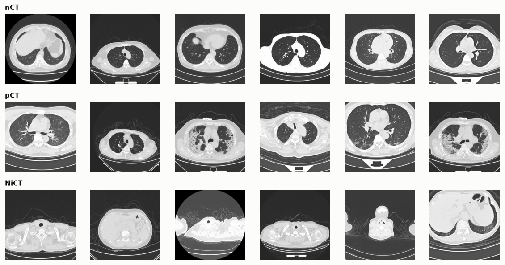
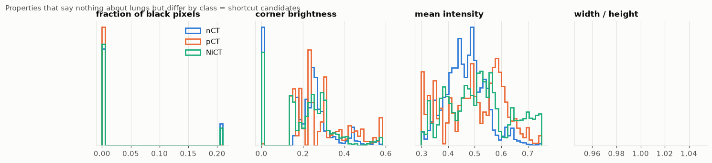
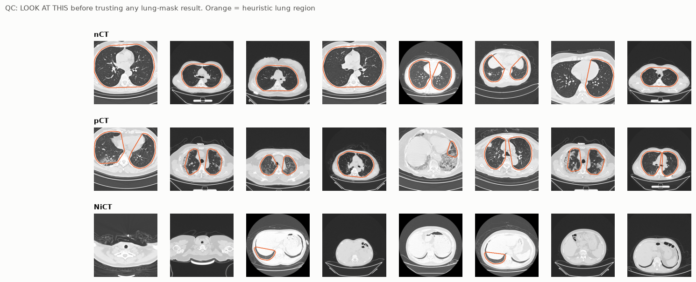
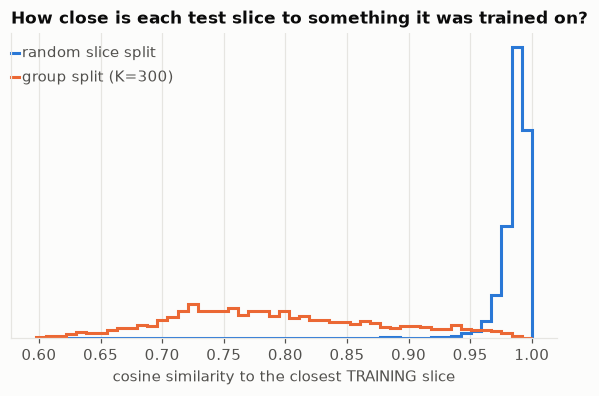
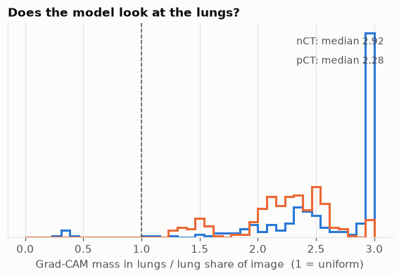
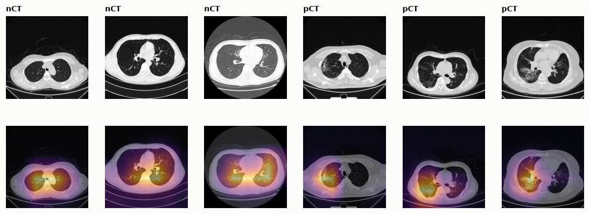
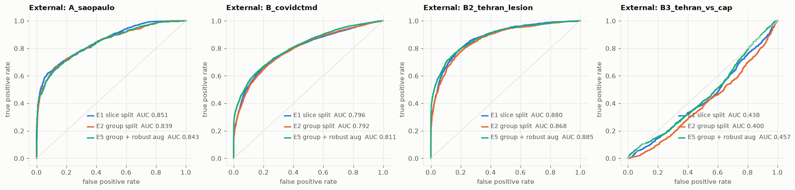

# covid-ct-audit

**Beyond 99%: Auditing Leakage, Shortcuts and Calibration in COVID-19 CT Classification**
Sayantan Bhattacharya · Techno Main Salt Lake, Kolkata 

[](LICENSE)


**Paper:** [PDF](paper/beyond99percenttest1.pdf) · **Raw log of the full run:** [results/all_outputs.txt](results/all_outputs.txt) · **Data card:** [docs/DATA.md](docs/DATA.md)

<!-- After the Zenodo upload add: **DOI:** https://doi.org/10.5281/zenodo.XXXXXXX -->

---

## In one paragraph

A public COVID-19 CT slice classifier reports **99.76%** test accuracy using a random split of individual slices. Slices from one scan are near-duplicates, so that split can leak: the model may recognise scans it has already seen instead of recognising disease. This project re-evaluates a MobileNetV3-Large classifier (3 classes: nCT / pCT / NiCT, 19,685 slices) with progressively more honest protocols, tests whether it relies on shortcuts that have nothing to do with the lungs, evaluates it on two external hospitals, measures how well its probabilities hold up under that shift, and checks the whole approach against true patient IDs on a third dataset. Everything reruns from one script on a single consumer GPU (RTX 3060 Ti, 8 GB).

## Key findings

All numbers are means over 3 seeds. Details, tables and caveats are in the paper.

| Question | Result |
|---|---|
| Accuracy, slice split vs recovered-group splits | **99.42%** vs 97.18% (feature groups) and 95.39% (file-order groups). The error rate is 4.9x and 8.0x higher. COVID recall falls from 99.6% to 96.0% and 88.8%. |
| Can scan metadata alone solve the task? (15 scalar features such as image size and brightness) | Balanced accuracy **0.996** under a slice split but **0.630** under a group split. Those features identify slices, not disease. |
| Does the model need the lungs? | A model that never sees the lungs scores **0.930** balanced accuracy; one that sees only the lungs scores **0.929**. The label can be read from outside the lungs. |
| Does the model look at the lungs? | Grad-CAM lung enrichment has a median of 2.9 (nCT) and 2.3 (pCT) where 1.0 means uniform attention. It looks at the lungs but also depends on other content. |
| External validity | AUROC 0.83 on Sao Paulo and 0.86 on Tehran (COVID lesion slices vs normal). |
| COVID vs community-acquired pneumonia (Tehran) | AUROC **0.43 to 0.49** for every model. Every model scores pneumonia as *more* COVID-like than COVID. |
| Calibration under shift (binary ECE) | 0.02 in-domain vs **0.19 to 0.53** on external sets. Temperature scaling gains at most 0.034. |
| Do recovered "pseudo-patient" groups match real patients? (Tehran, true IDs) | Adjusted Rand index at most **0.29**. The recovered groups keep **37%** of the nearest-neighbour leakage advantage, so the slice-vs-group gaps reported here are lower bounds. |

## Figures

### The data and what it can give away


**Fig. 1.** Example slices for each class. NiCT slices show little or no lung, which matters for the shortcut analysis.


**Fig. 2.** Properties that say nothing about the lungs but differ by class: fraction of black pixels, corner brightness, mean intensity and aspect ratio.


**Fig. 3.** Quality control of the heuristic lung masks (orange outline). They are plausible on most slices but often merge both lungs and the mediastinum, which the paper treats as a limitation.

### Leakage


**Fig. 4.** Same model, different protocols. Balanced accuracy on each protocol's test split (dots are seeds, bars are means). Only the split changes between E1 and E2.


**Fig. 5.** Frozen-feature probes (blue: linear, orange: 1-nearest-neighbour) as the recovered groups get stricter (fewer groups). The curves are partly circular, because the same embedding built the groups. Section 8 of the paper gives the independent check.


**Fig. 6.** How close each test slice is to something it was trained on. A random slice split (blue) puts most test slices at cosine similarity 0.96 to 1.00; a group split with K = 300 (orange) spreads them out.

### Shortcuts


**Fig. 7.** Share of Grad-CAM mass inside the lung mask divided by the mask's share of the image. Median 2.92 for nCT and 2.28 for pCT (1.0 would be uniform).


**Fig. 8.** Grad-CAM overlays for the first three nCT and first three pCT test slices (not selected for appearance).

### External validity and calibration


**Fig. 9.** External ROC curves for E1, E2 and E5 (seed 0). On the COVID-vs-pneumonia set (bottom right) every curve lies below the diagonal.


**Fig. 10.** Reliability diagrams for the E2 model (seed 0), blue raw and orange temperature-scaled. In-domain, ECE is 0.021; externally it is 0.19 to 0.53.

## Experiments

| ID | Split | Input | Augmentation | Accuracy | Balanced acc. |
|---|---|---|---|---|---|
| E1 | Slice (random) | Full image | Basic | 0.9942 | 0.994 |
| E2 | Feature groups | Full image | Basic | 0.9718 | 0.969 |
| E2f | File-order groups | Full image | Basic | 0.9539 | 0.935 |
| E3 | Feature groups | Lungs removed | Basic | 0.9266 | 0.930 |
| E4 | Feature groups | Lungs only | Basic | 0.9222 | 0.929 |
| E5 | Feature groups | Full image | Robust | 0.9717 | 0.969 |
| E6 | Feature groups | Lungs only | Robust | 0.9193 | 0.925 |

Each experiment runs with seeds 0, 1 and 2 (21 runs, 44.6 minutes in total on an RTX 3060 Ti).

### External discrimination (AUROC, mean over 3 seeds)

| Experiment | Sao Paulo | Tehran: COVID vs normal (B2) | Tehran: COVID vs pneumonia (B3) |
|---|---|---|---|
| E1 slice | 0.826 | 0.861 | 0.460 |
| E2 feature groups | 0.832 | 0.862 | 0.425 |
| E2f file-order groups | 0.804 | 0.845 | 0.442 |
| E3 lungs removed | 0.734 | 0.644 | 0.433 |
| E4 lungs only | 0.643 | 0.889 | 0.472 |
| E5 robust | 0.862 | 0.887 | 0.452 |
| E6 lungs only, robust | 0.625 | 0.890 | 0.490 |

## Method summary

- **Pseudo-patient groups.** The main dataset has no patient IDs. Each slice becomes a 96-dimensional vector (64 PCA components of frozen MobileNetV3 features plus 32 PCA components of a 32 x 32 thumbnail). Average-linkage clustering with cosine distance (K = 300) gives "feature groups". A second proxy clusters only neighbouring file numbers within a class ("file-order groups"). A group split guarantees no cluster appears on both sides of the train/test boundary.
- **Model and training.** MobileNetV3-Large (ImageNet-1k weights) with a small head, AdamW (learning rate 1e-4, weight decay 1e-4), batch size 32, 8 epochs, checkpoint with the lowest validation loss. Splits are 72/14/14.
- **Shortcut tests.** Gradient-boosted trees on 15 scalar acquisition features, lung-removed and lung-only inputs from heuristic masks, test-time ablation, a Shortcut Reliance Index, and Grad-CAM lung enrichment.
- **External evaluation.** Sao Paulo (SARS-CoV-2 CT-scan dataset) and Tehran (COVID-CT-MD, with slice-level lesion labels and a community-acquired-pneumonia group as hard negatives).
- **Calibration.** ECE before and after temperature scaling fitted on in-domain validation data. In-domain ECE is a 15-bin three-class estimator and external ECE a 10-bin binary one, so the two are not directly comparable.
- **Uncertainty.** Seed spread, Wilson intervals, design effect and effective sample size, cluster bootstrap, exact McNemar tests.
- **Group-recovery check.** On Tehran, recovered clusters are compared with true patient IDs (adjusted Rand index, pair precision and recall), and nearest-neighbour and linear probes are run under random, recovered and true patient splits.

## A short audit protocol you can reuse

| Check | How | What it found here |
|---|---|---|
| 1. Split | Group by patient or scan whenever IDs exist; otherwise report slice and at least two proxy-group splits and say so | Gap of 2.2 and 4.0 points; error 4.9x and 8.0x |
| 2. Leakage probe | 1-NN on frozen features under your split, compared with a random split | 0.998 (random) vs 0.551 (true patient split) |
| 3. Metadata baseline | Gradient boosting on scalar acquisition features, slice vs group split | 0.996 vs 0.630 |
| 4. Region ablation | Train and test with lungs removed and lungs only; add Grad-CAM; inspect the masks | 0.930 and 0.929; enrichment 2.3 to 2.9 |
| 5. External site and hard negatives | AUROC plus sensitivity and specificity at a fixed decision, with a clinically adjacent negative class | AUROC 0.83 and 0.86; 0.43 against pneumonia |
| 6. Calibration | Reliability diagram on the external site | ECE 0.02 to 0.19 to 0.53 |
| 7. Proxy validation | Compare recovered groups with true IDs on any site that has them | ARI at most 0.29; 37% of the leakage retained |

## Datasets

Images are **not** included. Download each dataset from its own source and respect its licence (see [docs/DATA.md](docs/DATA.md)).

| Role | Dataset |
|---|---|
| Training and in-domain test | Kaggle `azaemon/preprocessed-ct-scans-for-covid19` (19,685 slices; counts match the iCTCF resource) |
| External A | Kaggle `plameneduardo/sarscov2-ctscan-dataset` (Sao Paulo, 2,481 slices) |
| External B and group-recovery check | COVID-CT-MD, figshare collection 5129081 (Tehran, 305 patients with true IDs) |

## Reproduce

```bash
pip install -r requirements.txt            # install the CUDA build of PyTorch first
bash scripts/get_data.sh                   # or scripts\get_data.ps1 on Windows (needs a Kaggle API token in the environment)
python covid_ct_audit.py --smoke --ext-b data/extB_raw/COVID-CT-MD   # quick check, about 5 minutes
python covid_ct_audit.py --ext-b data/extB_raw/COVID-CT-MD           # full run, about 45 minutes on an RTX 3060 Ti
```

Outputs (figures, CSV tables, a results summary) go to `work/`. `covid_ct_audit.ipynb` is the same pipeline as a notebook; its last cell (`scripts/cell_14_export.py`) exports every cell output. Experiments used PyTorch 2.14.1 with CUDA 12.6 on Windows.

## Repository layout

```
covid_ct_audit.py        the whole pipeline (data, groups, training, audits, figures)
covid_ct_audit.ipynb     the same pipeline as a notebook
scripts/                 data download scripts, Tehran label alignment, notebook output export
results/all_outputs.txt  raw log of the full run that the paper's numbers come from
paper/                   preprint PDF and figures
docs/DATA.md             data card
requirements.txt         dependencies
CITATION.cff             citation metadata
```

## Limitations

- Groups on the main dataset are recovered, not true patient IDs, so the leakage gaps there are lower bounds.
- One backbone and three seeds. Differences smaller than a few seed standard deviations are suggestive at best.
- Lung masks are heuristic, checked visually and not against ground truth. They often merge both lungs and the mediastinum, so the shortcut results inherit that.
- External sets differ in label definition, and the COVID-vs-pneumonia result rests on 25 patients without patient-clustered intervals.
- In-domain and external calibration use different estimators.
- This is research code and makes **no clinical claim**.

## Roadmap

True-patient-ID experiments on COVID-CT-MD, a ground-truth check of the lung masks, five seeds with patient-clustered intervals, more backbones, and a planted-shortcut benchmark to test the audit tools themselves.

## Cite

```bibtex
@misc{bhattacharya2026beyond99,
  author = {Bhattacharya, Sayantan},
  title  = {Beyond 99\%: Auditing Leakage, Shortcuts and Calibration in COVID-19 CT Classification},
  year   = {2026},
  note   = {Preprint, not peer-reviewed. Code: https://github.com/PopcornKitsilano/covid-ct-audit}
}
```

See also [CITATION.cff](CITATION.cff). Code is released under the MIT licence; each dataset keeps its own licence. Research use only.
